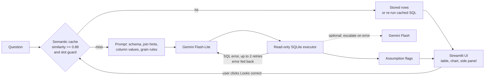

# Results and design notes

Details behind the main README: architecture, measured results, failure analysis and limitations.

Ask a question about the Olist e-commerce data in plain English. The app writes the SQL, runs it read-only on SQLite, shows the table and a chart, and tells you whether the answer came from the semantic cache or the model.

Built with Python, SQLite, Gemini (Flash-Lite as the cheap model, Flash as the strong one), sentence-transformers and Streamlit. The part I spent most time on is the evaluation harness: every change below was kept or dropped based on a measured number.

## How it works

1. **Cache lookup.** The question is embedded (all-MiniLM-L6-v2) and compared to cached questions by cosine similarity. A hit needs similarity of at least 0.88 and no slot conflict (see the guard below). A hit returns stored rows with no model call.
2. **Prompt.** Schema, join hints, the allowed values of low-cardinality columns, and four grain rules (for example: count distinct orders, not payment rows).
3. **Generate, execute, retry.** The SQL runs through a read-only executor. If it errors, the error is fed back and the model retries, up to 2 times.
4. **Assumption flags.** If the SQL filters on an order status or a year the question never mentioned, the UI shows a warning.
5. **Confirm before caching.** An answer is only cached when the user clicks "Looks correct, save to cache", so a wrong answer does not keep coming back.

## Results

**Setup.** Dev set: 30 hand-written hard questions (`eval/questions_hard_v2.json`) with gold SQL. Metric: execution accuracy, meaning the result set of the generated SQL is compared with the result set of the gold SQL, not the SQL strings. Each configuration ran 3 times, shown as mean ± the spread across runs. Model: Gemini 3.5 Flash-Lite unless stated.

### What each change was worth

| Configuration | Accuracy (3 runs) |
|---|---|
| No join hints | 65.6% ± 1.6 |
| Baseline (join hints) | 74.4% ± 1.6 |
| + error-feedback retries (max 2) | 85.6% ± 3.1 |
| + retries + few-shot examples | 76.7% (rejected, worse than retries alone) |
| + retries + column sample values | 82.2% ± 1.6 |
| + retries + grain rules | 91.1% ± 1.6 |
| **+ retries + sample values + grain rules** | **94.4% ± 1.6** |

Few-shot examples made it worse (76.7% vs 85.6% with retries alone), so I dropped them. Grain rules were the biggest single gain. Grain errors (counting rows instead of distinct orders, or a join that multiplies rows) were the largest failure group, and the rules target them.

Held-out set: `eval/questions.json`, 30 easy questions the prompt was never tuned on, scored 100%. That set is easy, so it shows I did not break the easy cases, not that the hard-question number generalises.

### Semantic cache

Cache eval: 30 seeded questions, then 52 queries (20 paraphrases, 22 near-misses that look similar but need a different answer, 10 unrelated). A "wrong hit" is a cache hit whose stored SQL gives a different result than the question being asked.

| Setting at 0.88 | Cache hits | Paraphrases answered from cache | Wrong hits |
|---|---|---|---|
| Threshold only | 30 | 65% | 17 (56.7% of hits) |
| Threshold + slot guard | 13 | 65% | **0** |

- Mean top-1 similarity: paraphrases 0.894, near-misses 0.921, unrelated 0.682. Near-misses score higher than paraphrases, so no threshold alone can separate them. Raising it to 0.98 removed the wrong hits but also removed every correct one.
- The slot guard blocks a hit when the two questions differ on a number, a named place, a max/min word, an aggregate (total vs average), a comparator (above vs below) or a status word. With it on, wrong hits drop to 0 at 0.88.
- Lookup takes 5.7 ms on average against 1.27 s for a cheap-model call (on this 52-query mix the cache cut total model latency by 24.6%).
- Stored results make a hit instant: one repeat-customer question took about 8 s as a miss and 0.013 s as a hit.

### Routing and cost

Cost per query is computed from logged tokens and published prices (thinking tokens count as output). The strong model's introductory price ends 2026-12-31, so cascade costs are shown for both price sets.

| Setup | Accuracy | Cost per query | Escalated |
|---|---|---|---|
| Always cheap (Flash-Lite) | 94.4% ± 1.6 | $0.000666 | 0/90 |
| Cascade: escalate on error or complex SQL | 93.3% ± 2.7 | $0.0018 to $0.0030 | 18/90 |
| Cascade: escalate on error only | 95.6% ± 1.6 | $0.0007 to $0.0008 | 1/90 |

An always-strong run was not done (the free tier allows only 20 requests a day on the strong model).

The cascade that escalates on "complex" SQL cost about 2.7 to 4.5 times more and scored lower than always-cheap. Reading the failures showed why: question h05 was passed by the cheap model but escalated and then failed 3 out of 3 times, because the strong model chose a different (defensible) reading of the question. The error-only cascade only escalated 1 of 90 questions, and its +1.1 points over always-cheap is one question, which is noise at this size. So the honest conclusion is that on this dataset, cheap model plus retries is the best setup, and routing did not earn its cost.

## Failure analysis

After the best configuration, three questions still failed in the cascade run. I re-ran their SQL against the database and compared by hand.

| Question | What happened | Verdict |
|---|---|---|
| h07: percentage of orders paid in more than one installment | One run counted payment rows instead of orders (49.42% vs gold 51.46%) | Genuine model error (grain). The other two runs were correct |
| h18: product in the most distinct orders | Run 0 found the right product and count (467) but added a category column, which the scorer rejects. Run 1 returned the category name instead of the product | Scorer strictness in one run, misreading "product" in another |
| h05: monthly 2017 revenue and change vs previous month | The model computed the change over all months, then filtered to 2017, so Jan 2017 is compared with Dec 2016. Gold filters first, so Jan 2017 is NULL | Gold is arguable: Dec 2016 exists, so the model's answer is defensible. The question is ambiguous |

I did not change the gold SQL or the scorer to improve the numbers. The reported accuracies are as measured. Roughly one to two of the remaining failures are about how the question is read, not about SQL skill.

### Ambiguity in the live app

The same question asked three ways ("average days between a customer's first and second order") gave 80.85, 88.47 and 80.35. The model made a different unrequested call each time: whether to exclude canceled orders, how to break timestamp ties, how to define "second purchase". The app shows the SQL and flags unrequested filters, and only caches answers the user confirms, so a cache hit keeps returning the one confirmed reading.

## Limitations

- **Small sample.** 30 dev questions, so one question is 3.3 points. Differences of a point or two are noise.
- **Dev set leakage.** The grain rules were written after reading dev-set failures, and the slot guard was tuned after seeing the near-miss set. The dev number (94.4%) is therefore optimistic. The held-out set is easy and does not fully validate either. A fresh set of near-misses would be the right next test for the guard.
- **Execution accuracy** can mark semantically different SQL as correct (a query that happens to return the same rows) and correct SQL as wrong (extra columns, defensible alternative readings).
- **The guard is rule-based.** It catches slot differences it was built for (numbers, names, max/min, aggregates, comparators, status words). Questions that differ in other ways can still produce a wrong hit.
- **Assumption flags cover two cases** (unrequested status filter, unrequested year). A query that counts canceled orders by not filtering gets no warning.
- **Latency of the strong model** is inflated by free-tier throttling (5 requests a minute) and should not be quoted. Cheap-model latency (about 1.3 s) was clean.
- Pricing for the strong model comes from third-party sources, since the provider's page could not be fetched.
